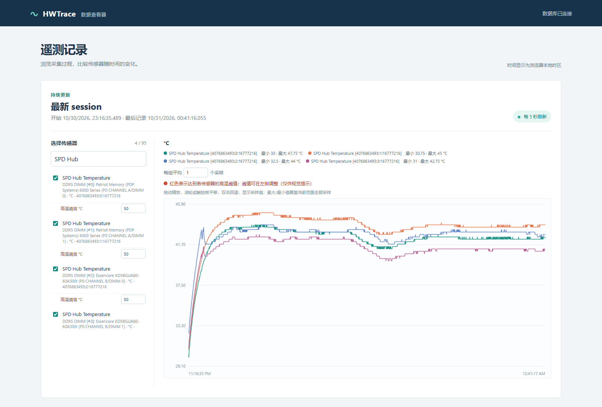

# HWTrace

**记录 DIMM 温度、内存供电和测试事件，在浏览器里回看整个测试过程。**

[English](README.md) | 简体中文

[](https://github.com/POEG1726/HWTrace/releases/download/v0.1.0/HWTrace-v0.1.0-windows-x64.zip)
[全部版本](https://github.com/POEG1726/HWTrace/releases/latest) ·
[部署指南](docs/deployment.md) · [Dashboard 指南](docs/dashboard.md)

长时间跑 DDR5/TM5 时，HWTrace 可以记录温度和电压变化，标记测试进程的出现与退出，
并在测试后对比不同传感器的曲线。项目附带 DDR5 配置，也可以选择 HWiNFO 暴露的
CPU、GPU 和其他硬件读数。



*图中为四根 DDR5 DIMM 的实际 SPD Hub 温度记录。支持传感器选择、缩放、平移、
悬停查看数值和按传感器设置温度参考阈值。*

## 下载与开始使用

1. **下载并解压上方 Windows x64 运行包。** 内含编译好的采集器、启动脚本、
   接收端和 dashboard，无需自行编译。
2. **准备接收端：** Linux、WSL 或 Windows 均可，需要 Python 3.12+ 和 SSH 服务。
   配置从采集机到接收机的 SSH 密钥登录，参照[部署指南](docs/deployment.md)。
3. **配置采集器：** 将 `collector.example.json` 复制为 `collector.json`，
   填写接收端 SSH 命令。启动 HWiNFO Sensors，开启 Shared Memory Support，
   将轮询间隔设为 **500 ms**。在已登录的 Windows 桌面上，用 PowerShell 7 运行：

   ```powershell
   pwsh -NoProfile -File .\Start-HWTrace.ps1
   ```

4. **在接收端查看图表：**

   ```sh
   python dashboard.py --db /path/to/hwtrace.sqlite3 --open-browser
   ```

   Windows 下也可以双击 `Open-Dashboard.cmd`，打开项目目录内的
   `data/hwtrace.sqlite3`。数据库在首次接收遥测时创建。

HWiNFO 需要单独安装并遵守其许可要求，发行包不包含 HWiNFO。
采集端还需要 Windows OpenSSH Client；接收端无需安装第三方 Python 包。

> **启动截图：** 使用 PowerShell 启动脚本时，如果受监控进程已经运行，会在采集开始时
> 异步截取全部活动显示器，并传给接收端。截图可能包含其他应用。
> 需要不带截图的采集时，可以直接运行原生采集器，见下文。

## 工作方式与功能

```text
Windows 采集机                                  Linux / WSL / Windows 接收机
HWiNFO 共享内存 -> 原生 C 采集器 -- 持久 SSH / JSONL --> SQLite WAL
                    启动时全屏截图 -- 独立 SSH / PNG --> screenshots/
                                                           |
                                                   只读 Web dashboard
```

- **500 ms 采样：** 直接读取 HWiNFO Shared Memory，采集机使用固定大小的内存队列，
  不写本地遥测数据库、日志或截图文件。
- **可配置传感器：** 保留名称、单位、传感器 ID、实例和读数 ID，以区分重名项目。
- **测试事件：** 默认监控 `TM5.exe`，记录检测到的进程出现、退出和手动标记。
  启动脚本不会启动 TM5 或其他压力测试程序。
- **退出后继续记录：** 最后一个同名进程退出后继续采集 10 分钟；期间重启则取消停止。
  从未检测到目标进程时不会因此自动停止。延时和进程名称可配置。
- **断线重连：** SSH 重连后重试未确认的记录，接收端按会话与序号去重。
- **时间关联：** 保存 UTC 时间、单调计时和截图实际复制区间，便于对齐记录。

运行期间，在终端输入一行文字并按 Enter 可添加手动标记；Ctrl+C 停止。
使用无截图的原生采集器：

```powershell
$config = Get-Content .\collector.json -Raw | ConvertFrom-Json
.\build\hwtrace.exe .\ddr5.filter $config.ssh_command TM5.exe 600
```

## 传感器配置

`ddr5.filter` 是初始配置，包含 DIMM SPD 温度、VDD/VDDQ/VPP、VIN/VOUT、功耗和
PMIC 状态，以及 CPU/CCD/IOD/VRM 温度、SoC/VDDIO、内存带宽、MCLK/FCLK/UCLK、
HWiNFO 暴露的时序、内存占用和 WHEA 计数。实际可用项取决于硬件和 HWiNFO。

每个非注释行是不区分大小写的读数名称子串，或 `传感器组名称子串|读数名称子串`。
右侧为空时选择该组全部读数；空配置文件选择全部读数，仍受单条记录大小限制。
配置在启动时加载，修改后需手动重启采集器。请以实际名称和数据库元数据核对匹配项；
更换硬件或升级 HWiNFO 后应重新确认 ID。

## Dashboard

默认访问 `http://127.0.0.1:8765/`。界面使用中文，时间显示为浏览器本地时区。

- 最新会话每 5 秒刷新，也可以选择历史会话。一次采集器运行对应一个会话，SSH 重连沿用原会话。
- 每个面板最多选择 50 个传感器，按单位分别绘图，图例包含稳定 ID 和当前范围的极值。
- 悬停显示最近的已绘制点及实际时间；横向拖动缩放，滚轮或触控板平移，双击回退一级。
- 每张图支持按 1–10,000 个实际采样分组平均，尾组可能不足；时间取组内最后一次采样。
- 温度参考阈值可逐个传感器修改或关闭。内存相关名称默认 50 °C，其他默认 80 °C，
  仅作视觉提示，不代表硬件安全限值。

长记录约抽样为每个传感器 2,000 个点。抽样和平均可能隐藏短暂峰值。
图例极值使用抽样前的数据；启用平均时显示平均组的极值。
最后记录时间表示数据新鲜度，不能证明 SSH 当前在线。

Dashboard 以只读方式访问数据库，不控制采集器、HWiNFO 或测试进程。
它不带登录验证，默认只监听 localhost；远程查看建议使用 SSH 隧道。
数据库和截图由接收端保管，均为普通未加密文件。
更多操作、HTTP 接口与访问说明见 [Dashboard 指南](docs/dashboard.md)。

## 从源码编译与测试

源码需要 Windows MinGW-w64 GCC，或 WSL 的交叉编译器。下载运行包的用户可以跳过此步。

```powershell
pwsh -NoProfile -File .\scripts\build.ps1 -Compiler gcc
```

使用 WSL 时，先在 WSL 安装 `gcc-mingw-w64-x86-64`，然后运行：

```powershell
pwsh -NoProfile -File .\scripts\build.ps1 -UseWsl
```

产物为 `build/hwtrace.exe`。完整测试还需要 Python 3.12+、PowerShell 7 和
Node.js 18+（仅用于开发测试，运行 dashboard 不需要 Node.js 或 npm 包）：

```powershell
pwsh -NoProfile -File .\scripts\test.ps1 -UseWsl
# Windows 编译器改用 -Compiler gcc
```

测试使用合成读数、图片和离屏位图，不截取真实桌面、不启动压力测试。
只运行 Python 测试：`python -m unittest discover -s tests -v`。

## 限制与排障

- 内存环形队列为 128 个 64 KiB 槽，单条记录必须放得下。队列满时丢弃新记录，
  包括事件；没有磁盘缓冲。退出最多等待 5 秒发送，仍有待发送或丢弃记录时返回非零。
- 截图和采样并非原子同步，操作系统调度可能产生延迟，应使用实际截图区间进行关联。
- 每 500 ms 检查进程，极短进程可能被漏过。已运行进程的开始事件是检测时间，
  不追溯其真实启动时间。
- HWiNFO 未发布的样本无法补回；关闭共享内存、许可限制或断线会影响可用性。
- 稳定性判断仍需要实际压力测试，遥测记录本身不提供硬件稳定性认证。

只读诊断：`build/hwtrace.exe --diagnose`。另见[排障指南](docs/troubleshooting.md)、
[测试覆盖](docs/validation.md)、[数据协议](docs/protocol.md)和[安全说明](SECURITY.md)。

## 许可证

[MIT](LICENSE)。复用代码的来源及原始许可见
[THIRD_PARTY_NOTICES.md](THIRD_PARTY_NOTICES.md)。欢迎提交兼容性反馈与改进，
参照 [CONTRIBUTING.md](CONTRIBUTING.md)。
